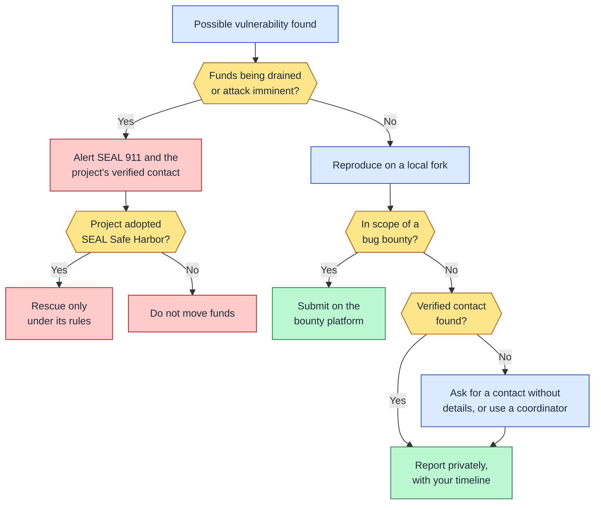
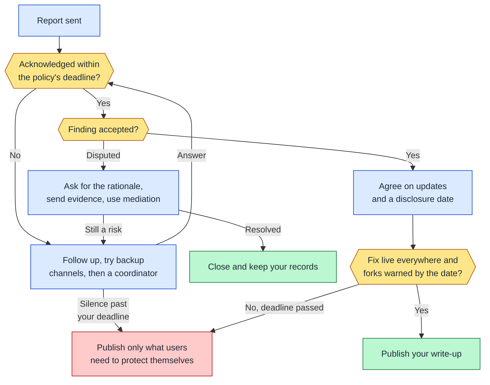
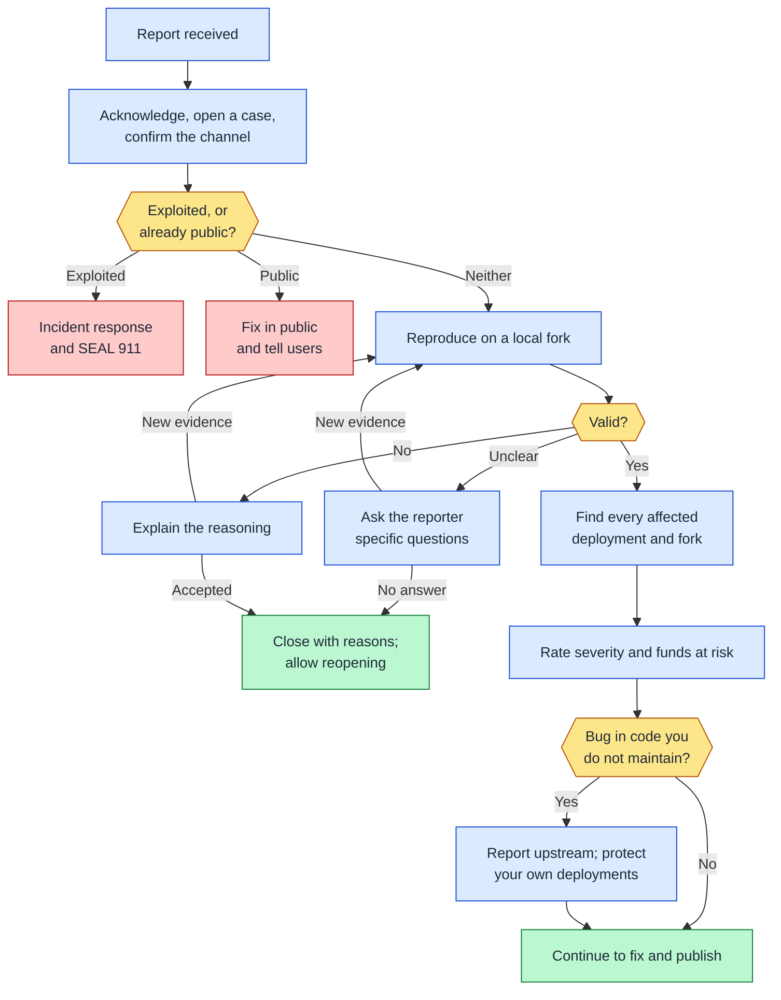
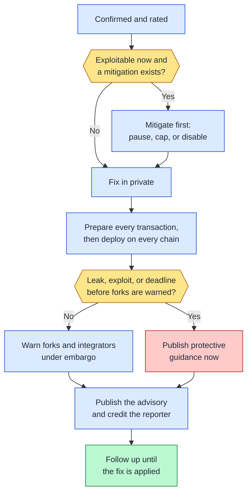

import { TagList, AttributionList, ContributeFooter } from '../../../components'

# Disclosure Decision Trees

<TagList tags={frontmatter.tags} />
<AttributionList contributors={frontmatter.contributors} />

> 🔑 **Key Takeaway**: Every disclosure decision comes down to a few questions: is anyone exploiting it, who can fix it,
> is the other side responding, and is everyone protected yet. Follow the tree for your side.

These trees summarize the two sides of coordinated disclosure: the researcher who found a vulnerability, and the
organization that received the report. Each tree is split into two stages so it stays readable. Select a step to jump
to the section that explains it.

Colors mark the type of step: amber hexagons are decisions, blue boxes are actions, red boxes are emergency or
exception paths, and green boxes are where a stage ends.

## Researcher decision tree

For anyone who found a vulnerability in someone else's code. Details are in
[Reporting a Vulnerability](/vulnerability-disclosure/reporting-a-vulnerability).

### Find and report

### After reporting

## Organization decision tree

For the team that received a report. Details are in
[Handling Vulnerability Reports](/vulnerability-disclosure/handling-reports) and
[Publishing Security Advisories](/vulnerability-disclosure/publishing-advisories). A bug bounty adds a separate track
for reward eligibility, duplicates, and payout, but the vulnerability is handled the same way whether or not it
qualifies for a reward.

### Intake and triage

### Fix and publish

## Further reading

- [Reporting a Vulnerability](/vulnerability-disclosure/reporting-a-vulnerability): the researcher's side in full
- [Handling Vulnerability Reports](/vulnerability-disclosure/handling-reports): the organization's steps from report to
  fix
- [Exceptional Cases](/vulnerability-disclosure/exceptional-cases): what both sides do when a case leaves the normal
  path

---

<ContributeFooter />
